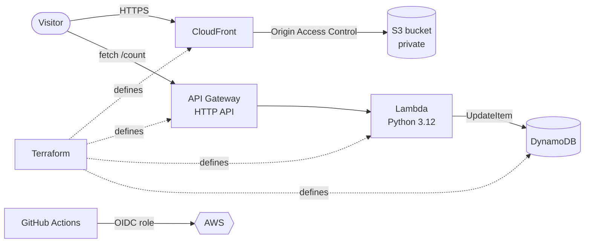

# Cloud Resume Challenge on AWS

My resume website, built and deployed on AWS as part of the [Cloud Resume Challenge](https://cloudresumechallenge.dev/). The site is static, the visitor counter is serverless, all infrastructure is written in Terraform, and every push to `main` is tested and deployed automatically with GitHub Actions.

**Live site:** [here](https://d3i5atppklo4gp.cloudfront.net/)

## Architecture



## How it works

1. **Frontend:** plain HTML, CSS and JavaScript, stored in a private S3 bucket. CloudFront serves it over HTTPS, and Origin Access Control means only CloudFront can read the bucket.
2. **Visitor counter:** on page load, JavaScript calls `GET /count` on API Gateway. A Python Lambda function increments a counter in DynamoDB with an atomic `ADD` update and returns the new value.
3. **Infrastructure as code:** all AWS resources are defined with Terraform (17 resources), with remote state in S3.
4. **CI/CD:** a GitHub Actions workflow runs the backend tests, applies Terraform, syncs the frontend to S3 and invalidates the CloudFront cache.

## Tech stack

| Area | Tools |
|---|---|
| Frontend | HTML, CSS, vanilla JavaScript |
| Hosting | Amazon S3, Amazon CloudFront |
| Backend | AWS Lambda (Python 3.12), Amazon API Gateway (HTTP API), Amazon DynamoDB |
| Infrastructure | Terraform |
| CI/CD | GitHub Actions with OpenID Connect (no stored AWS keys) |
| Testing | pytest, moto |

## Repository structure

```
cloud-resume/
├── frontend/
│   ├── index.html
│   ├── style.css
│   └── counter.js
├── backend/
│   ├── app.py              # Lambda handler for the visitor counter
│   ├── pytest.ini
│   └── tests/
│       └── test_app.py
├── infra/
│   ├── main.tf             # providers and S3 remote state
│   ├── variables.tf
│   ├── terraform.tfvars
│   ├── frontend.tf         # S3, CloudFront, Origin Access Control
│   ├── backend.tf          # DynamoDB, Lambda, IAM, API Gateway
│   └── outputs.tf
└── .github/workflows/
    └── deploy.yml
```

## Security and cost decisions

- **Private bucket:** S3 Block Public Access is on. Only CloudFront can read the site files.
- **Least privilege:** the Lambda role may only run `dynamodb:UpdateItem` on one table, plus basic logging.
- **No stored credentials:** GitHub Actions assumes an AWS role through OIDC. The role trusts only this repository and the `main` branch, and its permissions are limited to the services this project uses.
- **CORS:** the API only accepts requests from the site's CloudFront address.
- **Cost controls:** API throttling (1 request per second, burst of 5), 7-day log retention, on-demand DynamoDB, CloudFront `PriceClass_100`, and AWS budget alerts. The project runs on an AWS Free plan account and uses the default `cloudfront.net` domain instead of a paid domain.

## Run the tests locally

Requires Python 3.12.

```bash
python -m venv .venv
source .venv/bin/activate        # Windows PowerShell: .venv\Scripts\Activate.ps1
pip install pytest moto boto3
pytest backend/tests
```

The tests use `moto` to mock DynamoDB, so they never touch a real AWS account.

## Deploy it yourself

You need an AWS account, the AWS CLI, Terraform 1.11 or newer, and a GitHub repository.

1. **Create a bucket for Terraform state** (versioning on), and put its name in the `backend "s3"` block of `infra/main.tf`.
2. **Set a unique site bucket name** in `infra/terraform.tfvars`.
3. **Deploy the infrastructure:**
   ```bash
   cd infra
   terraform init
   terraform plan
   terraform apply
   ```
4. **Connect the frontend to the API:** copy the `api_url` output into `API_URL` in `frontend/counter.js`.
5. **Upload the site:**
   ```bash
   aws s3 sync frontend/ s3://<site_bucket> --delete
   aws cloudfront create-invalidation --distribution-id <distribution_id> --paths "/*"
   ```
6. **Set up CI/CD:** create a GitHub OIDC identity provider and an IAM role in your AWS account, then save the role ARN as the repository secret `AWS_ROLE_ARN`. After that, every push to `main` deploys automatically.

To remove everything, empty the site bucket and run `terraform destroy`.

## What I learned

- Designing a small serverless system and giving each component only the permissions it needs.
- Writing infrastructure as code and reading `terraform plan` output before applying.
- Setting up passwordless CI/CD with GitHub OIDC. My first attempt failed because the token's `sub` claim for my repository included numeric owner and repository IDs, so my trust policy never matched. Printing the real claim in the workflow log showed the fix.
- Keeping an AWS project within a credit budget.

## Roadmap

- [ ] Admin-editable project list (CRUD API with Amazon Cognito authentication)
- [ ] Architecture and write-up on my blog

## Author

**Afifah Dwi Rahmadani**
[LinkedIn](https://www.linkedin.com/in/afifahdrahmadani/) · afifahdrahmadani@gmail.com
